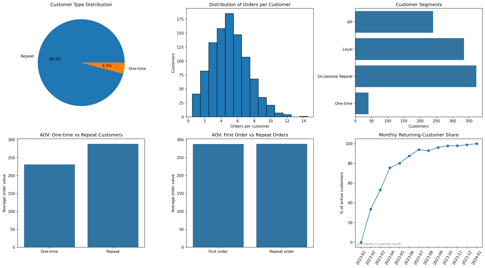

# Task 28: Customer Repeat Purchase Analysis

**Veda Technology - Data Analytics Track**

Measures repeat purchase behaviour, compares order values, and segments customers by loyalty, using Python and SQL.

## Dataset
`data.csv`: 5,000 invoice lines, 989 customers, UK only, 2023-01-01 to 2024-01-01 (Online Retail style columns: InvoiceNo, StockCode, Description, Quantity, InvoiceDate, UnitPrice, CustomerID, Country). The data has no nulls, duplicates or negative values. It appears synthetic, so treat the absolute numbers with caution.

## Approach
1. **Order level, not row level.** Line items are summed per invoice: `order_value = SUM(Quantity x UnitPrice)`. Returns (Quantity <= 0), zero prices and rows without a customer are dropped.
2. **Repeat customer** = a customer with **2 or more distinct orders**. Everyone else is one-time.
3. **Repeat rate** = repeat customers / all customers.
4. **AOV compared two ways**: one-time vs repeat customers, and each customer's first order vs their later orders.
5. **Segments** (mutually exclusive):
   - **VIP**: 5+ orders and total spend above the 75th percentile
   - **Loyal**: 5+ orders
   - **Occasional Repeat**: 2-4 orders
   - **One-time**: 1 order
6. **Time views**: monthly returning-customer share and cohort retention.

## Results
| Metric | Value |
|---|---|
| Customers | 989 |
| Repeat customers | 948 |
| **Repeat rate** | **95.85%** |
| AOV, one-time customers | 231.07 |
| AOV, repeat customers | 288.47 (**+24.8%**) |
| AOV, first orders | 287.68 |
| AOV, later orders | 288.08 |

| Segment | Customers | % customers | % revenue | Avg orders | AOV |
|---|---|---|---|---|---|
| VIP | 240 | 24.3% | 42.9% | 7.42 | 346.87 |
| Loyal | 335 | 33.9% | 32.9% | 5.92 | 238.95 |
| Occasional Repeat | 373 | 37.7% | 23.5% | 3.20 | 283.63 |
| One-time | 41 | 4.1% | 0.7% | 1.00 | 231.07 |



## Insights
- **Repeat rate is very high (95.9%)**: far above typical retail rates, which supports the view that this dataset is synthetic or limited to engaged customers.
- **Repeat customers place larger orders** than one-time customers (+24.8%), but a repeat customer's later orders are about the same size as their first order. They don't spend more per order over time; they order more often. The one-time group is only 41 customers, so treat that gap with caution.
- **VIPs are 24% of customers but 43% of revenue.** The one-time group contributes under 1%.
- **Returning-customer share rises from 34% in February 2023 to 99% by December 2023** as the customer base builds up. The first month is 0% by definition and January 2024 is a single day.
- **Cohort retention is flat**: each cohort has roughly 30-38% of customers ordering in any later month.

## Recommendations
1. Build a VIP/loyalty tier to protect the 43% of revenue they drive.
2. Run a win-back campaign for the 41 one-time customers.
3. Nudge Occasional Repeat customers (2-4 orders) towards a 5th order.
4. Test upsell offers on repeat orders, since their AOV is flat compared with first orders.

## Interview questions
**How do you define a repeat customer?** A customer with at least two distinct orders in the analysis window. The definition should be stated up front, because changing the window or threshold changes the repeat rate.

**Why track repeat rate?** It measures loyalty and retention. Repeat customers are cheaper to retain than new customers are to acquire, so a rising repeat rate usually means better lifetime value and more predictable revenue.

## Files
| File | Purpose |
|---|---|
| `repeat_purchase_analysis.py` | Full Python pipeline (`python repeat_purchase_analysis.py --data data.csv`) |
| `repeat_purchase_analysis.sql` | SQL version, standard SQL (tested on SQLite) |
| `run_sql_sqlite.py` | Loads `data.csv` into SQLite, runs the SQL, writes `sql_output.txt` |
| `sql_output.txt` | Output of every SQL query |
| `customer_metrics.csv`, `customer_segments.csv`, `segment_summary.csv`, `aov_comparison.csv`, `monthly_repeat_rate.csv`, `cohort_retention.csv` | Result tables |
| `repeat_purchase_analysis.png` | Charts |

## How to run
```bash
pip install pandas matplotlib seaborn
python repeat_purchase_analysis.py --data data.csv --output-dir .
python run_sql_sqlite.py --data data.csv --sql repeat_purchase_analysis.sql
```
The Python and SQL results were cross-checked and match.
